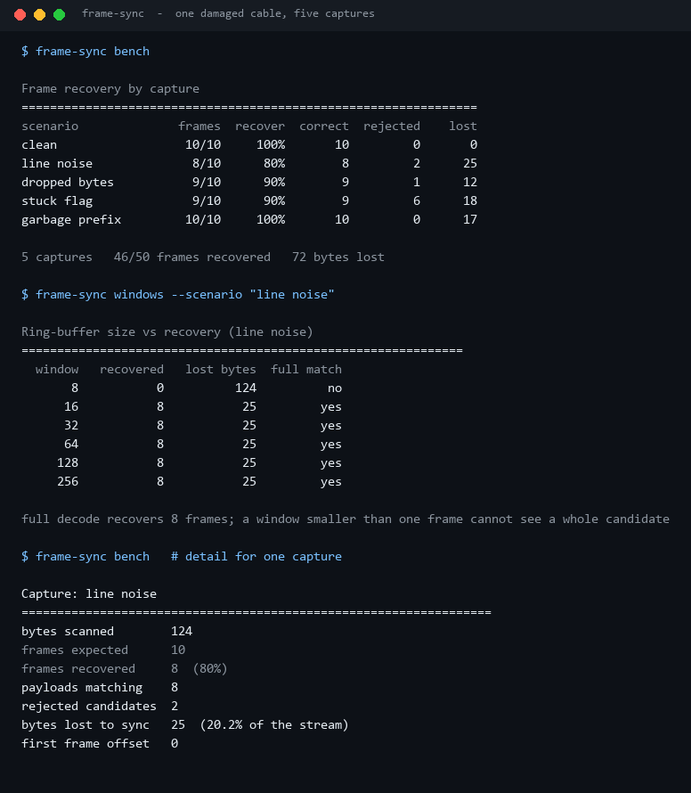
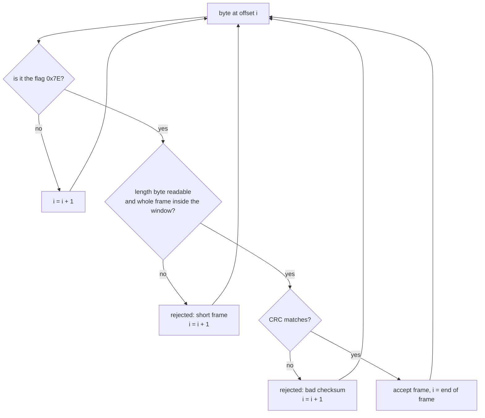
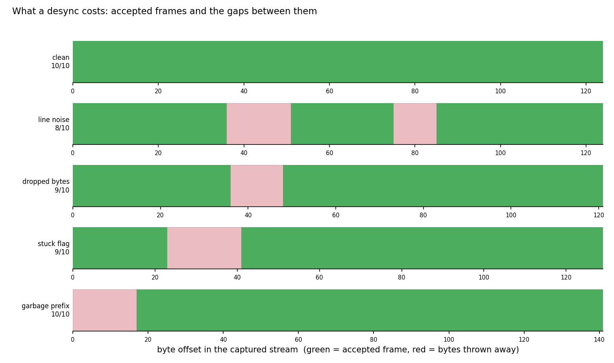
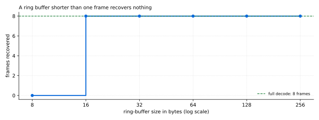

# Frame-Sync-Analyzer

**When a serial link loses framing, the interesting question is not "did it break" - it is "how many bytes did the recovery throw away, and how few bytes of buffer do you need to recover at all".**

This decodes an HDLC-style, length-prefixed, CRC-16 protected byte stream, hunts for the next flag
byte after every rejection, and reports what the hunt cost.



Every number above comes from `scripts/render_assets.py` running this repository's code.

---

## Table of contents

- [Why this exists](#why-this-exists)
- [The wire format](#the-wire-format)
- [The hunt loop](#the-hunt-loop)
- [What a desync costs, measured](#what-a-desync-costs-measured)
- [How much buffer does recovery need](#how-much-buffer-does-recovery-need)
- [Install and run](#install-and-run)
- [Commands](#commands)
- [Design notes and limits](#design-notes-and-limits)
- [Tests](#tests)
- [License](#license)

---

## Why this exists

Firmware serial protocols are everywhere - sensors, bootloaders, GPS modules, RS-485 buses - and
almost all of them use the same shape: a flag byte, a length, a payload, a checksum. The decoder is
20 lines of code that everybody writes once and nobody tests against damage, which is why field
failures look like "the board sometimes stops responding" instead of a number.

Three properties are measurable, and this tool measures them:

1. **Recovery** - how many frames survive a given kind of damage.
2. **Cost** - how many bytes are discarded while searching for the next valid frame.
3. **Buffer requirement** - the smallest receiver window that can still recover, because a firmware
   decoder keeps a fixed-size ring buffer and cannot grow it.

## The wire format

| Field | Size | Notes |
| --- | ---: | --- |
| flag | 1 byte | `0x7E`, HDLC-style |
| length | 1 byte | payload length, 0-255 |
| payload | `length` bytes | opaque |
| checksum | 2 bytes | CRC-16/CCITT-FALSE, little endian, over flag+length+payload |

CRC-16/CCITT-FALSE is the standard variant (poly `0x1021`, init `0xFFFF`, no reflection, no final
xor), so the check value for `123456789` is `0x29B1` - the project asserts that in a test rather
than trusting memory:

```
$ frame-sync crc --text 123456789
payload  b'123456789'
crc16    0x29B1
```

Because the payload is opaque, it can contain `0x7E`. That is intentional: a decoder must not
trust a flag byte, it must *prove* a candidate with its checksum.

## The hunt loop



One byte at a time, never skipping: a payload that contains a flag byte produces a rejected
candidate and then the scanner walks *into* the payload and finds the real frame right after it.
Skipping to the next flag after a rejection would look tidier and silently lose frames - the
`stuck flag` capture below is exactly that scenario.

## What a desync costs, measured



| Capture | Damage | Frames | Recovered | Rejected candidates | Bytes lost |
| --- | --- | ---: | ---: | ---: | ---: |
| clean | none | 10 | 10 (100%) | 0 | 0 |
| line noise | 2 bit flips | 10 | **8 (80%)** | 2 | **25 (20.2%)** |
| dropped bytes | 3 bytes lost mid-stream | 10 | 9 (90%) | 1 | 12 |
| stuck flag | 5 spurious flag bytes | 10 | 9 (90%) | 6 | 18 |
| garbage prefix | 17 bytes of cold-start junk | 10 | 10 (100%) | 0 | 17 |

46 of 50 frames recovered across the five captures, 72 bytes discarded in total.

Two results are worth staring at:

- **A single byte shift is not a single frame loss.** Dropping 3 bytes destroys one frame *and*
  leaves the next boundary misaligned, so the decoder also discards the front of the following
  frame. 3 damaged bytes cost 12 bytes of stream - a 4× amplification.
- **A garbage prefix costs bytes but not frames.** `garbage prefix` throws away 17 bytes, yet
  recovers all 10 frames: the damage is a one-time offset, not a recurring loss. This is why
  "dropped frames" and "bytes lost" have to be reported separately.

Line noise is the expensive case: 2 flipped bits (one inside a payload, one inside a header) break
CRC on two frames and cost a fifth of the stream.

## How much buffer does recovery need



The longest frame in this corpus is `2 + 9 + 2 = 13` bytes. A receiver that only ever holds 8
bytes can never see a whole candidate, so it recovers **0 of 8** frames:

```
  window   recovered   lost bytes  full match
       8           0          124          no
      16           8           25         yes
      32           8           25         yes
```

16 bytes is already enough - half of the 32-byte ring buffer a lot of firmware allocates for no
reason. The measurement turns "give it a big buffer, it's only RAM" into a specific number: **one
frame plus one** is the size that matters, and nothing above it changes.

## Install and run

Standard library only - no `pyserial`, no hardware.

```bash
python -m pip install -e ".[dev]"
frame-sync bench
```

From a checkout without installing:

```bash
PYTHONPATH=src python -m frame_sync_analyzer bench
```

Decode your own capture (hex text, 16 bytes per line, `-` reads stdin):

```bash
frame-sync decode --file examples/capture.hex
```

## Commands

| Command | What it does |
| --- | --- |
| `bench [--format text\|json]` | decode all five built-in captures and tabulate recovery |
| `decode --file CAPTURE` | decode a hex dump and list the payloads |
| `windows --scenario NAME` | recovery against ring-buffer size |
| `captures` | list the built-in captures and their damage |
| `encode --text STR` | wrap a payload in a frame and print the hex |
| `crc --text STR` | checksum a payload |

## Design notes and limits

- **The checksum is the only oracle.** A frame is accepted when CRC-16 matches. CRC-16 has a
  1-in-65536 chance of accepting a corrupted frame, and this tool does not model that: on a very
  noisy link the accepted-but-wrong frames are a real effect that only application-level framing
  (sequence numbers, length plausibility) catches.
- **No resynchronisation hint.** Real protocols often add a break condition, an idle-timeout reset,
  or a byte-stuffing rule. None of that is modelled; the decoder here only knows flag, length, CRC.
- **Damage is synthetic and reproducible.** Bit flips use a seeded RNG, so the committed numbers
  are exactly reproducible on any machine - no timing involved.
- **`decode_windows` is a model, not a firmware binary.** It simulates "only 8 bytes visible at
  once" by truncating the lookahead. Real ring buffers can also drop bytes while the CPU is busy,
  which is a different failure mode.
- **CRC choice.** CRC-16/CCITT-FALSE is common on serial links; CRC-16/ARC, CRC-8 and XOR checksums
  are just as common and are weaker. The 1-in-65536 figure is specific to the 16-bit variant.

## Tests

```bash
PYTHONPATH=src python -m pytest -q     # 35 passed
python -m ruff check .                 # All checks passed!
```

35 tests cover the CRC check value, frame layout, round-trips, truncated tails, payload bytes that
contain the flag, corrupted payload rejection and recovery, windowed decoding, every measurement
field, and every CLI command.

## License

MIT. See [LICENSE](LICENSE).

---

<sub>Screenshots and charts are generated by `scripts/render_assets.py` from this repository's own
output. No third-party images are used.</sub>
